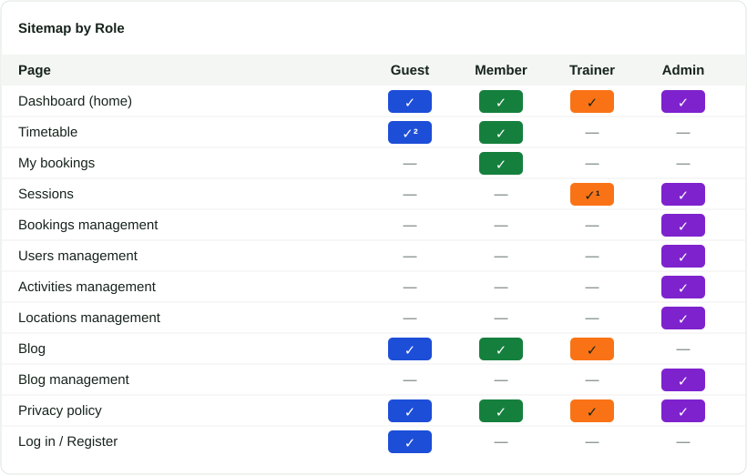
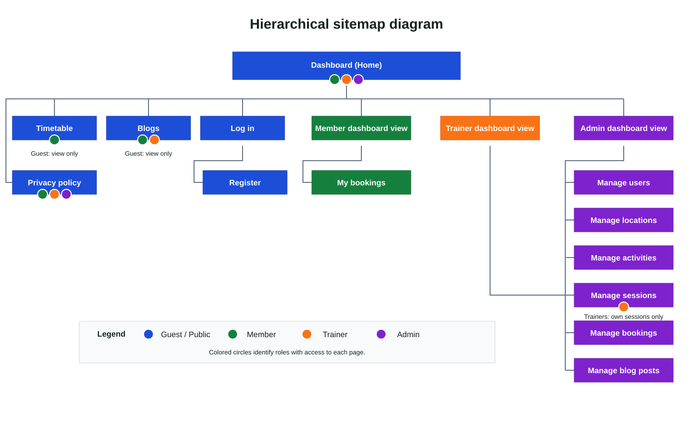

# Gym app

Gym app for Tafe stage 2 assessment

- Backend MVC app
- Backend JSON API with interactive Swagger documentation
- Frontend React app (coming soon)

## Backend Gym App


### Architecture


### Bookings

The desktop and mobile menus highlight the current page section, including its
record-edit pages. This works with or without JavaScript.

On the Bookings page, selecting **All locations** shows the session location beneath each booking. Selecting a specific location hides this extra line.

### Backend API

All API endpoints use the `/api/v1` prefix.
Open `/api/v1/docs/` for interactive Swagger documentation, or `/api/v1/openapi.json`
for the OpenAPI specification. The specification includes request examples,
field limits, response schemas, error codes, and role/ownership rules.

1. Send `POST /api/v1/authenticate` with JSON
   `{"username":"your-email@example.com","password":"your-password"}`.
2. Copy the returned `key` into Swagger's **Authorize** dialog, or send it as
   the `x-auth-key` request header.
3. Send `DELETE /api/v1/authenticate` to revoke the key. Logging in again replaces
   the previous key.

| Resource        | Endpoints                                   | Access                                                                                                                |
| --------------- | ------------------------------------------- | --------------------------------------------------------------------------------------------------------------------- |
| Current profile | `GET /api/v1/user/self`                     | Any authenticated user                                                                                                |
| Users           | `GET/PUT /api/v1/users/{id}`                | Members/trainers can read and update only their own record, without changing role                                     |
| Sessions        | `DELETE /api/v1/sessions/{id}`              | Trainers can delete only their own sessions; session list/detail reads are not available                              |
| Timetable       | `GET /api/v1/timetable`                     | Members and trainers; next seven days, optional `location_id` and `trainer_id` filters                                |
| Bookings        | `/api/v1/bookings`, `/api/v1/bookings/{id}` | Members read/create/cancel their own bookings (no updates); trainers only read bookings for sessions assigned to them |
| Blogs           | `/api/v1/blogs`, `/api/v1/blogs/{id}`       | Guest/member/trainer reads; member/trainer writes restricted to the creator                                           |

Administrators cannot log in to the API or use existing API keys (returns `403`).
User listing/creation/deletion, all activity/location endpoints and session
list/detail reads, creation and updates are removed from the API and Swagger
documentation; use the timetable to browse sessions.
Booking updates remain access-restricted.
Guests without a key can only read blogs; documentation and login remain public.

Create/update bodies use JSON with snake_case field names. `PUT`
requires all editable fields, except user passwords and dates of birth may be
omitted to preserve their current values. Omit `user_id` when creating a booking
to use your own user ID. Blog authors and creation timestamps
are server-managed. User responses include the assigned role as a read-only field;
do not include it in updates. Passwords are bcrypt-hashed, and user responses never include
passwords or authentication keys. Changing your password revokes your API key;
omitting the password, leaving it empty (`"password": ""`) or supplying the
current password preserves it.
Use `GET /api/v1/user/self` to find your user ID,
then `PUT /api/v1/users/{id}` to update your details.

Creation returns `201`, the created record, and its `Location` header. Updates
return the updated record; deletion returns a message. Deleting a session also
deletes its bookings. Duplicate/overlapping bookings return `409`.

The API uses API keys rather than browser cookie sessions, validates JSON against
OpenAPI instead of the HTML form sanitiser, and does not require an
`Idempotency-Key` header. Browser page routes keep their existing middleware.

#### Auth keys for testing purposes

- Trainer: 7625c5aa-716e-4f9e-b70e-7c40078a9f4d
- Member: e8331a60-3567-4ea4-aafc-62cee5a05aa3

#### API access by role



### Sitemap by Role

**Role colors:**




¹ Trainers can manage only their own

² Guests can only view, not book sessions

### Hierarchical Sitemap

The Dashboard is the landing page for all roles. Its content changes for guests,
members, trainers and admins; the dashboard views below are not separate pages.



### Running the code

> There is NO NEED to run any speific database or schema creation SQL. The application takes care of this for you.

### Sample data

If you choose to seed sample data on your first install, the passowrd for all sample users is `testing123`.

Besides your app admin account, here are a few users to get you started:

#### Trainers

- dv@gym.com
- de@gym.com

#### Members

- ep@gym.com
- ww@gym.com

#### Development Environment

- You will need to have mySQL v8 or above installed and running
- Configure the .env file.

Example `backend/.env`:

```
# app settings
PORT=3000

# database connection settings
DB_HOST=127.0.0.1
DB_PORT=3307
DB_ROOT_PASSWORD=rootymctooty
DB_NAME=gym

# database app user credentials
DB_USER=gymuser
DB_PASSWORD=Testing123!

# app admin credentials
ADMIN_EMAIL=admin@gym.com
ADMIN_PASSWORD=testing123

# Seed sample data into database
DATA_SEED=true
```

- If you have just cloned this repo, run `npm i` and `npm i -w backend` to install prerequisit packages.
- From the top-level folder, run the following command `npm run devall -w backend`

> This is how you will start the app in development every time.

- A database initialisation script process is started. If this is a new installation the following will execute, otherwise these steps will skip:
  - Create the database
  - Create tables and foriegn keys
  - Create a database user account for the application
  - Set priviledges for database user account
  - Create an application admin user if there is no admin
  - Seed sample data if a new database and the seed option is true
- The application is then started and available locally on the specified port.

** Other dev options **

- Run unit and integration tests with individual test results and coverage `npm run test`
- Run eslint linter `npm run lint`
- Run prettier linter `npm run prettier:check`
- Generate JSDoc documentation _backend/src/public/docs_ `npm run jsdoc`
- Run tests with output to _test_results.txt_ file `npm run testfilee`

#### Docker (Recomended for production)

- Docker is installed and configured
- On your docker host machine, create and populate `.env` and `compose.yaml` files. Suggested options below:

Example `.env`:

```
# app settings
PORT=3000

# database connection settings
DB_HOST=127.0.0.1
# This is the port if you want to connect with mysql workbench. Change as needed
DB_PORT=3307
# Your mySQL root password
DB_ROOT_PASSWORD=rootymctooty
DB_NAME=gym

# database app user credentials
DB_USER=gymuser
DB_PASSWORD=Testing123!

# app admin credentials
ADMIN_EMAIL=admin@gym.com
ADMIN_PASSWORD=testing123

# Option to populate with same data (only on first install)
DATA_SEED=true

```

Example `compose.yaml` file

```
services:
  gymdb:
    image: mysql:8.0
    container_name: gymdb
    restart: unless-stopped
    environment:
      MYSQL_ROOT_PASSWORD: ${DB_ROOT_PASSWORD}
      MYSQL_ROOT_HOST: "%"
    ports:
      - ${DB_PORT}:3306
    volumes:
      - gymdb-data:/var/lib/mysql
    healthcheck:
      # $$ defers expansion to the container so the healthcheck uses its own root password.
      test:
        [
          "CMD-SHELL",
          'MYSQL_PWD="$$MYSQL_ROOT_PASSWORD" mysqladmin ping -h 127.0.0.1 -uroot',
        ]
      interval: 10s
      timeout: 5s
      retries: 10
      start_period: 180s

  gymapp:
    image: petersem/gym:latest
    container_name: gymapp
    restart: unless-stopped
    ports:
      - "3001:3000"
    environment:
      NODE_ENV: production
      PORT: 3000
      DB_HOST: gymdb
      DB_PORT: 3306
      DB_USER: ${DB_USER}
      DB_PASSWORD: ${DB_PASSWORD}
      DB_NAME: ${DB_NAME}
      DB_INIT_USER: root
      DB_INIT_PASSWORD: ${DB_ROOT_PASSWORD}
      DATA_SEED: ${DATA_SEED:-false}
      ADMIN_EMAIL: ${ADMIN_EMAIL}
      ADMIN_PASSWORD: ${ADMIN_PASSWORD}
    depends_on:
      gymdb:
        condition: service_healthy

volumes:
  gymdb-data:
```

Once you have configured these files, from the same directory, run `docker compose up -d gymapp` This will first create and install mySQL, and then it will create a container for the gym app.

> If this is the first time the database is being created, this process can take a couple of minutes before things are running. Be patient!

Once it says gymdb is `healthy` and gymapp says `running`, the app is ready to be opened in a browser on the docker host ip:[specified port]
